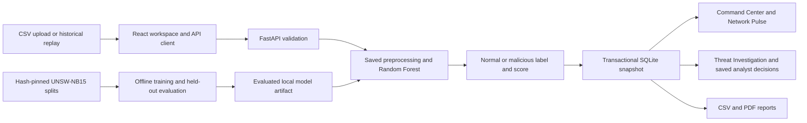

# NetSight AI
### Intelligent Network Traffic Analyser Using Machine Learning

> **Project Status:** Local academic MVP validated on November 18, 2026
> **Development:** Primarily Solo
> **Original MVP Target:** November 10, 2026
> **Mini-Project Submission:** November 21, 2026
> **Domain:** Computer Networks + Machine Learning

## Current implementation

The local application connects six workspace modules to one FastAPI workflow: validate a compatible flow CSV, run the saved Random Forest pipeline, store the result in SQLite, and reuse that saved analysis for the Command Center, Network Pulse, Threat Investigation, and CSV/PDF reports. Model Lab displays the model evidence; it is not part of prediction execution.

The installed model is **Random Forest v4** trained and evaluated on the hash-pinned UNSW-NB15 partitions. Its reported official held-out accuracy is **90.69%**, malicious recall **96.87%**, and false-positive rate **16.89%** (6,248 false alerts among 37,000 normal flows). The 5% false-positive limit applies only to validation threshold selection; it did not hold on the official test split. See [the complete evaluation and limitations](docs/model-evaluation.md).

Uploads must use the published 42-feature UNSW-NB15 flow contract. A newer dataset or an arbitrary CSV needs a schema adapter and its own independently evaluated pipeline. Network Pulse replays historical benchmark rows; it is not live capture. Threat actions are saved analyst decisions and simulated blocks; they do not change firewall rules or block real traffic.

## 1. Project Overview

NetSight AI is a web-based intelligent network traffic analysis platform that uses Machine Learning to analyze network communication, classify network traffic, identify potentially malicious activities, and visualize results through an interactive dashboard.

Traditional network monitoring tools often require manual packet inspection and predefined rules. NetSight AI aims to simplify the process by bringing traffic analysis, machine learning, investigation, and visualization into one unified interface.

The application is designed to make network traffic understandable, interactive, and accessible.

### Core Idea

Instead of showing users thousands of raw network records, NetSight AI processes compatible traffic data, runs it through a trained Machine Learning model, and presents meaningful insights through visualizations and reports.

**Core workflow:**

1. Collect or upload network traffic data.
2. Validate and preprocess the dataset.
3. Extract relevant network traffic features.
4. Analyze traffic using a trained ML model.
5. Classify traffic as normal or potentially malicious.
6. Visualize network activity and classification results.
7. Investigate suspicious traffic.
8. Generate downloadable analysis reports.

The project will include a historical traffic replay system for an interactive demonstration.

**Important:** Historical replay is not the same as real-time packet capture. The application must accurately label its data sources and detection modes.

---

## 2. Academic Project Information

| Field | Details |
|---|---|
| Project | Intelligent Network Traffic Analyser Using ML |
| Application Name | NetSight AI |
| Department | Computer Science and Engineering |
| Domain | Computer Networks |
| Presented By | Vidya, Prajwal, Harini |
| Batch | Batch 11, CSE-C |
| Mentor | Dr. L. Raghavendar Raju |
| Development Approach | Primarily solo-led |
| Completion Target | November 10, 2026 |
| Submission | November 21, 2026 |

The project is based on the original academic presentation covering network traffic analysis, Machine Learning, data preprocessing, traffic classification, and results visualization.

---

## 3. Problem Statement

Modern computer networks continuously generate large volumes of data packets.

Analyzing this traffic manually becomes difficult, especially when monitoring large amounts of network communication.

Traditional approaches include:

- Manual packet inspection.
- Rule-based network monitoring.
- Statistical traffic analysis.
- Multiple separate tools for processing and visualization.

These approaches have limitations:

- Manual inspection is time-consuming.
- Rule-based systems depend on predefined conditions.
- Complex patterns can be difficult to recognize.
- Separate tools increase workflow complexity.

### Proposed Solution

Develop an ML-powered network traffic analysis platform capable of processing compatible network traffic data, identifying normal and suspicious patterns, and presenting meaningful results through an interactive web dashboard.

The system combines network traffic processing, Machine Learning, visualization, and reporting into a structured workflow.

---

## 4. Project Objectives

### Primary Objectives

1. Obtain network traffic data for analysis.
2. Validate and preprocess network traffic datasets.
3. Extract useful network traffic features.
4. Train a suitable Machine Learning algorithm.
5. Classify network flows as normal or potentially malicious.
6. Visualize traffic patterns and classifications.
7. Allow investigation of individual network records.
8. Generate useful traffic analysis reports.

### Secondary Objectives

- Create a visually engaging monitoring dashboard.
- Demonstrate historical traffic scenarios.
- Compare normal and malicious traffic patterns.
- Display model evaluation metrics.
- Build a modular architecture for future expansion.
- Prepare a reliable interactive faculty demonstration.

---

## 5. Application Modules

The website will contain six main modules connected through one consistent application interface.

### 5.1 Command Center

The Command Center is the primary dashboard.

It provides a quick overview of the application's analysis results.

**Features:**

- Total analyzed traffic flows.
- Normal traffic count.
- Suspicious traffic count.
- Traffic distribution.
- Historical traffic activity chart.
- Recent analysis history.
- Recent suspicious classifications.
- Backend connection status.
- ML model availability and version.

The dashboard should load quickly and provide clear information without overwhelming the user.

Any sample or demonstration data must be clearly labeled.

### 5.2 Network Pulse

Network Pulse is the main interactive visualization module.

It displays network activity through connected nodes, animated links, and traffic flow information.

**Features:**

- Interactive network visualization.
- Animated traffic connections.
- Normal and suspicious traffic indicators.
- Clickable network elements.
- Traffic flow details.
- Historical traffic replay.
- Play, pause, restart, and replay-speed controls.
- Normal and suspicious traffic scenarios.

**Important implementation rule:**

Display actual device relationships only when source and destination information exists in the dataset.

When the dataset lacks this information, any illustrative topology must be labeled as a conceptual visualization.

The November 10 release will focus on historical traffic replay rather than real-time packet capture.

### 5.3 Traffic Analyzer

The Traffic Analyzer allows users to upload compatible network traffic datasets and receive ML classification results.

**Features:**

- Drag-and-drop CSV upload.
- File format validation.
- Missing-column detection.
- Data type validation.
- Dataset overview.
- Analysis progress indicators.
- ML prediction results.
- Normal versus malicious traffic counts.
- Classification result table.
- CSV result export.

The frontend will send the validated dataset to the FastAPI backend.

The backend will preprocess the data using the saved training pipeline and run actual ML inference.

Do not generate fake predictions when the ML model is unavailable.

### 5.4 Threat Investigation

The Threat Investigation module allows users to examine individual classified network flows.

**Features:**

- List of potentially malicious flow records.
- Classification labels.
- Model scores when available.
- Relevant network flow features.
- Traffic record details.
- Filtering and searching.
- Explanation of model-generated classifications.
- Analyst approval for a simulated block, or dismissal of an alert; decisions are saved with the analysis and can be undone.

The simulated IPS action is an educational workflow only. It does not block packets, modify a firewall, or change a network device. Only flows classified as malicious can receive a response decision.

The system must distinguish actual model output from general explanatory text.

Feature importance may help interpret predictions but should not be presented as definitive proof of an attack.

### 5.5 Model Lab

Model Lab provides information about the Machine Learning system.

**Features:**

- Model name and version.
- Algorithm details.
- Dataset information.
- Number of input features.
- Training and testing information.
- Accuracy.
- Precision.
- Recall.
- F1-score.
- Confusion matrix.
- Feature importance where supported.

All displayed evaluation metrics must come from actual model testing.

No hardcoded accuracy or fabricated model performance values are permitted.

### 5.6 Reports

The Reports module allows users to export and review network traffic analysis results.

**Features:**

- Analysis summary.
- Traffic classification totals.
- Model metadata.
- Dataset information.
- Analysis timestamp.
- Suspicious flow summaries.
- Saved analyst response decisions, labeled as simulated.
- CSV export.
- PDF report generation.

The exported reports must match the predictions and totals shown in the application.

---

## 6. Technology Stack

### Frontend

- React
- TypeScript
- Vite
- Tailwind CSS
- Custom CSS
- React Router
- Motion for React
- Lucide Icons

### Backend

- Python
- FastAPI
- Uvicorn
- Pydantic
- Pandas
- NumPy

### Machine Learning

- Scikit-learn
- Random Forest Classifier
- Logistic Regression for baseline comparison
- Pandas
- NumPy
- Joblib

### Database

- SQLite

### Reporting

- CSV export
- ReportLab for PDF generation

### Development Tools

- Git
- GitHub
- VS Code / OpenAI Codex
- Python virtual environment
- npm
- Browser developer tools

### Hosting Strategy

The application will initially run locally.

Frontend and backend will be executed as separate development services.

A cloud deployment is optional and must not block the project deadline.

The complete faculty demonstration should work without depending on internet connectivity.

---

## 7. System Architecture



The CSV analysis path, historical replay input, SQLite analysis history, backend CSV export, and PDF reports are implemented through the stages above. Actual classifications are shared across the main workspace pages. Device topology uses optional validated source/destination IP columns; files without these columns do not produce invented relationships. See [the architecture review](docs/architecture-review.md) for the stage-by-stage implementation map.

### Architecture Principles

1. Separate frontend and backend responsibilities.
2. Keep ML training separate from inference.
3. Use a consistent API contract.
4. Store model artifacts independently from application code.
5. Keep UI components reusable.
6. Validate all uploaded files.
7. Avoid unnecessary infrastructure.
8. Design for local execution first.
9. Make failures visible instead of returning invented results.

---

## 8. Machine Learning Implementation

### Dataset

The implemented model uses the academically documented [UNSW-NB15 dataset](https://research.unsw.edu.au/projects/unsw-nb15-dataset), a labeled network-flow intrusion-detection benchmark with official training and test partitions. A pinned public mirror is used by the downloader; provenance and file hashes are recorded locally. Academic use requires citing the dataset publications; commercial use requires permission from the dataset authors.

### Initial ML Goal

Binary classification for the selected benchmark:

- Normal traffic (`label=0`)
- Attack-labeled traffic (`label=1`, shown in the product as **malicious** for investigation)

The input contract has 42 flow features (39 numeric and `proto`, `service`, `state` categorical). Direct record ID (`id`), target (`label`), and attack category (`attack_cat`) are excluded from model input. A malicious prediction is a review signal, not proof of an incident.

Multiclass attack classification may be introduced later if the model produces satisfactory evaluation results.

### Proposed Algorithm

**Primary:** Random Forest Classifier

**Baseline:** Logistic Regression

Random Forest is selected because it works well with many structured tabular datasets and can represent nonlinear feature relationships.

Its performance must still be evaluated on the chosen traffic dataset.

### ML Pipeline

```text
Network Traffic CSV
        |
        v
Data Validation
        |
        v
Data Cleaning
        |
        v
Feature Selection
        |
        v
Training / Testing Split
        |
        v
Model Training
        |
        v
Model Evaluation
        |
        v
Save Trained Pipeline
        |
        v
FastAPI Inference
        |
        v
Classification Results
```

### Important Model Requirements

- Use appropriate training and testing separation.
- Avoid leakage between related traffic samples where possible.
- Handle missing and invalid values consistently.
- Preserve feature names and order.
- Store the trained preprocessing pipeline.
- Evaluate class imbalance.
- Calculate real model metrics.
- Save model metadata.
- Use held-out data for the faculty demonstration.

### Evaluation Metrics

- Accuracy and balanced accuracy
- Precision
- Recall
- F1-score
- Average precision and ROC-AUC
- Confusion matrix

Accuracy alone is insufficient for an imbalanced intrusion dataset. The implemented report includes precision, recall, F1, threshold-independent metrics, confusion matrix, and class support from held-out records. See [`docs/model-evaluation.md`](docs/model-evaluation.md) for actual measured results and limitations.

### Model Limitations

The system will classify supported network-flow records.

It cannot automatically claim to:

- Detect every unknown cyberattack.
- Prevent attacks.
- Block malicious traffic.
- Detect malicious URLs.
- Identify malware files.
- Monitor networks continuously.

These capabilities require additional implementations and evaluations.

---

## 9. API Design

Base URL:

`http://127.0.0.1:8000/api/v1`

### Phase 1 API

| Method | Endpoint | Purpose |
|---|---|---|
| GET | /health | Backend and model status |
| GET | /model/schema | Supported CSV feature contract |
| POST | /traffic/validate | Validate CSV input |

### Phase 2 API

| Method | Endpoint | Purpose |
|---|---|---|
| POST | /traffic/analyze | Run real ML inference |
| GET | /model/info | Return model metadata |

### Phase 3 API

| Method | Endpoint | Purpose |
|---|---|---|
| GET | /analyses | Analysis history |
| GET | /analyses/{id} | Analysis details |
| GET | /replays | Available replay scenarios |
| POST | /replays/{id}/analyze | Analyze selected replay |
| GET | /analyses/{id}/export.csv | CSV export |
| GET | /analyses/{id}/report.pdf | PDF report |
| GET | /analyses/{id}/response-decisions | Read saved analyst decisions |
| PUT | /analyses/{id}/flows/{row_id}/response | Record an approved simulated block or dismissed alert |
| DELETE | /analyses/{id}/flows/{row_id}/response | Undo a simulated response decision |

### Example Health Response

```json
{
  "status": "ok",
  "service": "netsight-api",
  "model_loaded": false,
  "model_version": null
}
```

### Example Analysis Response

The following JSON demonstrates the planned response structure. Its values are illustrative, not real ML results.

```json
{
  "analysis_id": "sample-001",
  "source_type": "uploaded_csv",
  "model_version": "netsight-rf-unsw-v1",
  "total_flows": 2,
  "counts": {
    "normal": 1,
    "malicious": 1
  },
  "predictions": [
    {
      "row_id": 1,
      "label": "normal",
      "malicious_score": 0.12
    },
    {
      "row_id": 2,
      "label": "malicious",
      "malicious_score": 0.88
    }
  ]
}
```

`malicious_score` is the pipeline's uncalibrated `predict_proba` value for benchmark class `1`. It is not attack confidence or proof of an incident. The API also returns a preview with model features and results for up to five rows. Example values above are illustrative and are not predictions.

### API Requirements

- Proper validation.
- Consistent response structures.
- Clear error messages.
- File-size restrictions.
- CSV schema validation.
- CORS configuration.
- Correct HTTP status codes.
- Proper model-loading errors.
- No fabricated predictions.
- Simulated IPS decisions must never be represented as real traffic prevention.

If the model has not been trained, evaluated, or cannot load, prediction requests should return an appropriate error such as HTTP 503.

---

## 10. Frontend Design System

### Visual Direction

Build a premium, modern, technical interface with an editorial layout and a clear, distinct identity.

Avoid generic cybersecurity templates and overused AI-generated website aesthetics.

### Theme

Primary theme: Dark, with a near-black canvas and restrained blue, red, and green signal colors.

### Color Palette

| Color | Hex | Usage |
|---|---|---|
| Canvas | #090D14 | Main background |
| Ink | #E9EEF7 | Main text |
| Signal Blue | #70A5FF | Network activity and primary interactions |
| Threat Red | #F36F7B | Suspicious traffic |
| Normal Green | #43C9A2 | Healthy status |
| Surface | #101722 | Panels and cards |

### Typography

- Space Grotesk: Headings
- Inter: Interface text
- Monospace with tabular figures: Scores, thresholds, and network identifiers

### Layout

- Compact, floating horizontal workspace navigation.
- Consistent navigation across the landing page and workspace.
- Spacious dashboard grid.
- Clearly differentiated sections.
- Responsive layout.
- High-contrast text.
- Readable charts.
- Clean data tables.

### Motion and Interaction

Use animations only when they serve an actual purpose. Sparse topology paths and slow terminal-like telemetry marks sit near the screen edges; they are decorative and never represent live traffic. Respect reduced-motion preferences.

Examples:

- Smooth page transitions.
- Network flow animations.
- Chart transitions.
- Interactive nodes.
- Hover details.
- Expandable alert panels.
- Replay progress indicators.
- Loading and success states.
- Slow, terminal-style telemetry marks at the outer edges of the background.
- A pause control, hidden-page pause, and reduced-motion support for background animation.

The background marks are decorative. They must stay clear of content and must not look like live traffic.

### Design Rules

Avoid:

- Random floating gradient blobs.
- Excessive glassmorphism.
- Generic glowing cybersecurity effects.
- Unnecessary animations.
- Inconsistent spacing.
- Hardcoded fake activity counters.
- Unreadable charts.
- Excessively decorative components.

The final website should feel like a carefully designed technical product rather than a generic AI-generated dashboard.

### Trust and Transparency

Every data-driven section should communicate whether it represents:

- Sample UI Data
- Historical Replay
- Uploaded Analysis
- Actual ML Prediction

The application must never make demo-only data look like live network monitoring.

---

## 11. Repository Structure

```text
netsight-ai/
|
|-- README.md
|-- .gitignore
|
|-- frontend/
|   |-- public/
|   |-- src/
|   |   |-- app/
|   |   |-- components/
|   |   |   |-- ui/
|   |   |   |-- charts/
|   |   |   |-- network/
|   |   |-- pages/
|   |   |-- services/
|   |   |-- fixtures/
|   |   |-- types/
|   |   |-- styles/
|   |   |-- main.tsx
|   |-- .env.example
|   |-- package.json
|
|-- backend/
|   |-- app/
|   |   |-- main.py
|   |   |-- api/
|   |   |-- schemas/
|   |   |-- services/
|   |   |-- db/
|   |   |-- core/
|   |
|   |-- ml/
|   |   |-- train.py
|   |   |-- evaluate.py
|   |   |-- artifacts/
|   |
|   |-- tests/
|   |-- .env.example
|   |-- requirements.txt
|
|-- data/
|   |-- samples/
|   |-- README.md
|
|-- docs/
|   |-- architecture.md
|   |-- model-evaluation.md
|   |-- faculty-demo.md
```

This is the planned repository structure.

Files and folders should be created as they are implemented.

Do not commit:

- Virtual environments.
- API secrets.
- Large raw datasets.
- Personal network captures.
- Generated databases containing sensitive information.

---

## 12. Local Development Setup

### Prerequisites

- Node.js and npm
- Python 3.12
- Git

### Backend setup

From the repository root, create and activate the environment, then install the pinned dependencies:

```powershell
cd backend
python -m venv .venv
.\.venv\Scripts\Activate.ps1
python -m pip install -r requirements.lock.txt
```

The evaluated model artifact and raw dataset are generated locally and are not stored in Git. On a new machine, prepare them once:

```powershell
python -m ml.download_dataset
python -m ml.train
python -m ml.evaluate
python scripts/check_setup.py
```

Then start FastAPI:

```powershell
uvicorn app.main:app --host 127.0.0.1 --port 8000
```

If a verified local model artifact already exists, the download, train, and evaluate steps are not needed at each startup. See the [ML pipeline guide](backend/ml/README.md) for artifact and evaluation behavior.

### Frontend setup

In a second terminal from the repository root:

```powershell
cd frontend
npm ci
npm run dev
```

Open the Vite URL shown in the terminal (normally `http://127.0.0.1:5173`). Vite forwards same-origin `/api` calls to FastAPI; no frontend API URL override is required for local development. The API is at `http://127.0.0.1:8000`, health at `/api/v1/health`, and interactive docs at `/docs`.

After installing dependencies and preparing the model once, the faculty demonstration can run without internet. Follow the [offline faculty demo guide](docs/faculty-demo.md).

### Local verification

With the API running, from `backend/` run:

```powershell
python scripts/check_release.py
python -m pytest tests -q
```

From `frontend/`, run `npm run build` for the production TypeScript and Vite build, `npm run test:smoke` for the fast browser smoke check, and `npm run test:release` for the full browser workflow and accessibility checks. See [the local runbook](docs/phase-1.md) for details.

---

## 13. Development Roadmap

The dates and task lists below preserve the original plan for project history. The current implementation and verified demo workflow are summarized in [Current implementation](#current-implementation) and [the release record](docs/release-completion.md).

### Phase 1: Frontend and Backend Foundation

**Target: November 5–6**

Priority: Establish a working application structure.

#### Frontend Tasks

- Initialize React + TypeScript + Vite.
- Set up Tailwind CSS.
- Configure project fonts.
- Establish design tokens.
- Build application navigation.
- Build sidebar and top navigation.
- Create all six page routes.
- Build reusable UI components.
- Start the Command Center dashboard.
- Add sample-state charts and tables.
- Add loading, empty, and error states.
- Create a centralized API client.

#### Backend Tasks

- Initialize FastAPI.
- Configure local CORS.
- Build health-check endpoint.
- Create API response schemas.
- Create CSV validation endpoint.
- Add basic error handling.
- Establish folder structure for ML services.
- Prepare SQLite configuration.

#### Integration Tasks

- Connect React to FastAPI.
- Fetch backend status.
- Display actual connectivity information.
- Verify CSV validation requests.
- Test backend failures.
- Confirm the frontend does not show fake model results.

#### Phase 1 Deliverable

A polished, navigable frontend connected to a functioning FastAPI backend.

The backend does not need to have a trained ML model during this phase.

### Phase 2: Machine Learning and Inference

**Target: November 6–7**

Tasks:

- Obtain a suitable labeled traffic dataset.
- Prepare a manageable dataset subset.
- Clean and validate the data.
- Select appropriate features.
- Split training and evaluation data.
- Train a baseline model.
- Train Random Forest.
- Evaluate performance.
- Save the fitted preprocessing/model pipeline.
- Implement model loading.
- Implement inference API.
- Connect CSV analysis to the model.

Deliverable:

A working pipeline capable of returning real predictions for compatible network-flow records.

### Phase 3: Dashboard Integration

**Target: November 8**

Tasks:

- Connect actual inference results to the dashboard.
- Implement real traffic classification cards.
- Populate traffic charts.
- Build results tables.
- Complete Threat Investigation.
- Implement analysis history.
- Show model information.
- Add clear prediction and error states.

Deliverable:

A functional ML-powered traffic analysis dashboard.

### Phase 4: Replay, Reports, and Demo

**Target: November 9–10**

Tasks:

- Prepare historical traffic scenarios.
- Build replay controls.
- Connect replay data to model inference.
- Add animated network visualization.
- Complete reporting.
- Integrate CSV export.
- Implement PDF export if time allows.
- Test application stability.
- Fix critical bugs.
- Prepare an offline faculty demo.

Deliverable:

A stable demonstration-ready mini-project.

### Final Review and Submission

| Date | Activity |
|---|---|
| Nov 11–12 | First faculty review |
| Nov 13–14 | Address technical feedback |
| Nov 15–16 | Improve UI and interaction polish |
| Nov 17–18 | Complete project report and PPT |
| Nov 19 | Mock presentation |
| Nov 20 | Final testing and backup |
| Nov 21 | Mini-project submission |

The November 10 target is an aggressive MVP target. Core reliability should take precedence over optional features.

---


## 14. Latest verification — November 18, 2026

- Clean Python 3.12 backend install from the pinned lock; FastAPI loaded v4 and initialized SQLite.
- Clean-environment training and held-out evaluation reproduced the v4 threshold and metrics in a temporary artifact; the active model remained unchanged.
- Existing v4 artifact re-evaluated on the hash-verified official UNSW-NB15 test partition; metrics matched its metadata.
- **66 backend tests passed**; five API integration checks passed.
- Clean and workspace frontend installs built successfully with TypeScript and Vite.
- Browser release regression passed with zero JavaScript errors, zero axe violations, and no horizontal overflow at 390, 768, and 1440 pixels.
- CSV upload, replay, saved history, linked views, simulated analyst actions, and CSV/PDF exports returned matching analysis data.

See [the detailed release record](docs/release-completion.md) for limitations and the exact checks. The full development dependency audit still reports four high findings in dev-only tooling; the production dependency audit reports zero.

---

## 15. Future Enhancements

Features outside the initial mini-project scope:

1. Authorized live packet capture.
2. PCAP file processing with compatible feature extraction.
3. Multiclass attack identification.
4. Additional anomaly-detection models.
5. Real-time alert notifications.
6. Extended analytics and comparison.
7. Authenticated multiuser accounts.
8. Long-term analysis storage.
9. Model retraining interface.
10. Advanced network topology visualization.

These are future possibilities, not features promised for November 10.

---

## 16. Responsible Use and Limitations

NetSight AI is an academic network traffic analysis project.

The application is intended for educational use, model evaluation, and authorized network traffic analysis.

Important limitations:

- ML classifications may contain false positives and false negatives.
- Model predictions are not proof of malicious behavior.
- Historical replay is not live packet monitoring.
- The system does not automatically prevent cyberattacks.
- Analyst-approved simulated IPS decisions do not affect live traffic or firewall settings.
- The model is limited by its training data and features.
- Raw PCAP support requires additional processing.
- Network data should only be analyzed with appropriate authorization.

The project's results must be represented accurately.

---

## 1.7 References

### Academic References

1. Nguyen & Armitage (2008), Internet Traffic Classification Using Machine Learning.
2. Moore & Zuev (2005), Internet Traffic Classification Using Bayesian Analysis Techniques.
3. Sharafaldin et al. (2018), Network Intrusion Detection Datasets.
4. Boutaba et al. (2018), Machine Learning in Networking.

### Technical Resources

CIC-IDS2017:
https://www.unb.ca/cic/datasets/ids-2017.html

React:
https://react.dev/

Vite:
https://vite.dev/

FastAPI:
https://fastapi.tiangolo.com/

Scikit-learn:
https://scikit-learn.org/

---

## 18. Faculty Demonstration

Use the [offline faculty demo runbook](docs/faculty-demo.md) for one-time setup, local startup, the suggested presentation flow, and recovery steps. The runbook uses the existing evaluated model and bundled real historical excerpts; it does not depend on internet after preparation.

### Development Principle

Build the smallest functional end-to-end workflow first.

Prioritize correct ML functionality, clean architecture, reliable integration, and thoughtful visual design.

**Project Vision: Make network traffic analysis understandable, interactive, and verifiable.**

## Phase 2 implementation

The React frontend and FastAPI foundation are connected to an UNSW-NB15 binary flow-classification pipeline. The pinned downloader, input validation, preprocessing, candidate comparison, grouped validation, threshold selection, held-out evaluation, `/traffic/analyze`, `/model/schema`, and `/model/info` are implemented. The API returns actual inference only when a trained and evaluated local artifact is installed; it does not fabricate predictions.

See [local development setup](docs/phase-1.md), [architecture and API contracts](docs/architecture.md), and the [model evaluation record](docs/model-evaluation.md).

To download and retrain the model, from `backend/` run `python -m ml.download_dataset`, `python -m ml.train`, and `python -m ml.evaluate`. The normalized raw CSVs stay under the ignored `data/raw/unsw-nb15/` directory. The trained artifact and metadata are generated under `backend/ml/artifacts/` and are not committed.

Analysis snapshots and per-flow features are saved in SQLite. Historical replay uses bundled, hash-verified official holdout excerpts and the same inference service as uploads. Reports are generated from saved results. Neither replay nor uploaded analysis is live packet capture. See [completion and release checks](docs/release-completion.md).


## Frontend quality update
All eight review priorities are implemented. See [quality checklist and measured audits](docs/frontend-quality.md). The production preview uses the same-origin Vite API proxy; the FastAPI contracts are unchanged. The logo now uses a derived SVG trace, and the dashboard chart uses a lightweight native SVG renderer.

## Frontend completion pass
See [the 18-area frontend checklist](docs/frontend-completion.md) for completed interactions, tests and remaining backend dependencies. The updated frontend includes a pausable background loop, session preferences, cancellable uploads, investigation filters/mobile details, network zoom/reset, real validation receipts, skeletons and error recovery.
